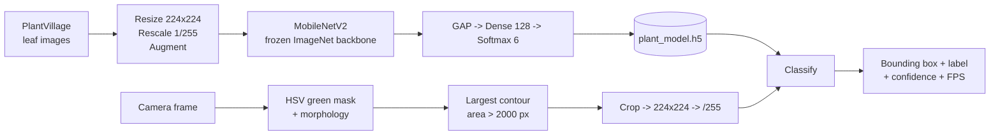

# AVIS — Autonomous Vegetation Imaging System

**Real-time crop disease detection from RGB imagery using a MobileNetV2 transfer-learning classifier.**


---

## Abstract

Early detection of plant disease is critical to sustainable agriculture, but manual crop
inspection is slow, inconsistent between inspectors, and largely inaccessible to small-scale
farmers. AVIS investigates whether commodity RGB imaging — a webcam today, a drone-mounted
camera in deployment — combined with a lightweight convolutional neural network can identify
diseased crops automatically and in real time.

A MobileNetV2 backbone pre-trained on ImageNet is used as a frozen feature extractor and
fine-tuned with a small classification head on **6,905 labelled leaf images** drawn from the
public [PlantVillage](https://github.com/spMohanty/PlantVillage-Dataset) dataset, spanning
**three crops** (bell pepper, potato, tomato) in **healthy** and **diseased** states. The
trained classifier is paired with a real-time OpenCV pipeline that segments vegetation from
the camera feed by HSV colour thresholding, crops the largest plant region, and classifies it
frame-by-frame with an on-screen confidence and FPS overlay.

The result is a fully offline, single-file inference loop small enough to run on
resource-constrained hardware — the intended path toward low-cost, automated aerial crop
monitoring.

---

## Table of contents

- [Method](#method)
  - [Pipeline](#pipeline)
  - [Dataset](#dataset)
  - [Model architecture](#model-architecture)
  - [Training configuration](#training-configuration)
  - [Real-time inference](#real-time-inference)
- [Results](#results)
- [Repository structure](#repository-structure)
- [Getting started](#getting-started)
- [Reproducibility](#reproducibility)
- [Limitations and known issues](#limitations-and-known-issues)
- [Roadmap](#roadmap)
- [Citation](#citation)
- [Acknowledgements](#acknowledgements)
- [License](#license)

---

## Method

### Pipeline



### Dataset

Images come from PlantVillage and are grouped into six `crop-condition` classes. Each crop's
"diseased" class corresponds to a **single specific pathology**, identifiable from the original
PlantVillage filename prefixes retained in this repository:

| Class | Pathology | Train | Val | Total |
|---|---|---:|---:|---:|
| `bell-pepper-diseased` | Bacterial spot (*Xanthomonas campestris*) | 696 | 301 | 997 |
| `bell-pepper-healthy` | — | 1,008 | 470 | 1,478 |
| `potato-diseased` | Late blight (*Phytophthora infestans*) | 594 | 406 | 1,000 |
| `potato-healthy` | — | 102 | 50 | 152 |
| `tomato-diseased` | Late blight (*Phytophthora infestans*) | 1,182 | 505 | 1,687 |
| `tomato-healthy` | — | 1,140 | 451 | 1,591 |
| **Total** | | **4,722** | **2,183** | **6,905** |

Class order is alphabetical, matching the index order Keras assigns via
`flow_from_directory` and the hardcoded `CLASSES` list in [`detect.py`](detect.py).

> [!IMPORTANT]
> The dataset is **strongly imbalanced** (`potato-healthy` has 152 images; `tomato-diseased`
> has 1,687 — an 11× gap). No class weighting or resampling is applied, so aggregate accuracy
> overstates performance on the minority classes. Read the per-class confusion matrix, not the
> headline number.

**Preprocessing and augmentation** (training split only):

| Step | Setting |
|---|---|
| Resize | 224 × 224 |
| Rescale | `1/255` |
| Rotation | ± 20° |
| Zoom | 0.2 |
| Horizontal flip | Yes |

The validation split is rescaled only — no augmentation — and loaded with `shuffle=False` so
that predicted and true label orderings align for the confusion matrix.

### Model architecture

```
Input (224, 224, 3)
  └─ MobileNetV2 (include_top=False, weights='imagenet', trainable=False)   ~2.26 M params, frozen
       └─ GlobalAveragePooling2D                                            → 1280-d feature vector
            └─ Dense(128, activation='relu')                                163,968 params
                 └─ Dense(6, activation='softmax')                          774 params
```

Only the head is trained: **≈ 164.7 K trainable parameters** out of ≈ 2.42 M total. Freezing
the backbone is what makes the model trainable on a few thousand images without overfitting
outright, and keeps the exported model small enough (~11 MB) for edge deployment.

### Training configuration

| Hyperparameter | Value |
|---|---|
| Optimizer | Adam (Keras defaults, lr = 1e-3) |
| Loss | Categorical cross-entropy |
| Metric | Accuracy |
| Batch size | 16 |
| Epochs | 10 |
| Backbone | Frozen throughout (no fine-tuning stage) |
| Output | `plant_model.h5` |

### Real-time inference

[`detect.py`](detect.py) runs a classical CV front-end ahead of the network rather than a
learned object detector — deliberately, to keep the loop cheap enough for onboard hardware:

1. Capture a frame (`cv2.VideoCapture(0)`) and mirror it.
2. Convert to HSV and threshold for vegetation: H ∈ [35, 85], S ∈ [40, 255], V ∈ [40, 255].
3. Clean the mask with a 5 × 5 morphological **open** followed by **dilate**.
4. Take the largest external contour; ignore it if its area ≤ 2,000 px (reported as `No Plant`).
5. Crop the bounding box, resize to 224 × 224, rescale to `[0, 1]`, and classify.
6. Draw the box (**green** = healthy, **red** = diseased), the label with softmax confidence,
   and a rolling FPS counter. `ESC` exits.

---

## Results

Running [`train.py`](train.py) writes three figures to `results/` (not committed):

| Artifact | Description |
|---|---|
| `results/accuracy.png` | Training vs. validation accuracy per epoch |
| `results/loss.png` | Training vs. validation loss per epoch |
| `results/confusion_matrix.png` | 6 × 6 confusion matrix over the validation split |

**Metrics from the latest run** — regenerate and fill in after training; do not cite figures
you have not reproduced:

| Metric | Value |
|---|---|
| Final training accuracy | _TBD_ |
| Final validation accuracy | _TBD_ |
| Final validation loss | _TBD_ |
| Weakest class (per confusion matrix) | _TBD_ |
| Wall-clock training time / hardware | _TBD_ |
| Inference throughput (FPS, live) | _TBD_ |

> [!WARNING]
> `dataset/val` is used **both** as the per-epoch validation set and as the evaluation set for
> the confusion matrix. There is no held-out test split, so these numbers are an optimistic
> upper bound, not an unbiased generalisation estimate. See
> [Limitations](#limitations-and-known-issues).

---

## Repository structure

```
AVIS/
├── train.py            # Transfer-learning training + evaluation figures
├── detect.py           # Real-time webcam detection & classification loop
├── plant_model.h5      # Pre-trained weights (~11 MB), ready for inference
├── dataset/
│   ├── train/          # 4,722 images across 6 class directories
│   └── val/            # 2,183 images across the same 6 classes
└── results/            # Generated by train.py (accuracy, loss, confusion matrix)
```

> The image corpus is committed to version control, so a full clone is **~126 MB**. Use
> `git clone --depth 1` if you only need a working copy.

---

## Getting started

### Requirements

- Python 3.9–3.11
- A webcam or USB camera (for `detect.py` only)
- ~2 GB free RAM for training at batch size 16; a GPU is optional but cuts training time
  substantially

### Installation

```bash
git clone --depth 1 https://github.com/vyom-aggarwal/AVIS.git
```

```bash
python -m venv .venv && source .venv/bin/activate
```

On Windows PowerShell, activate with `.venv\Scripts\Activate.ps1` instead.

```bash
pip install "tensorflow>=2.10,<2.17" opencv-python numpy matplotlib scikit-learn pillow
```

### Reproduce training

```bash
python train.py
```

Prints the resolved class list and model summary, trains for 10 epochs, overwrites
`plant_model.h5`, and writes the three figures into `results/`.

### Run live detection

```bash
python detect.py
```

Opens a `Plant Disease Detection` window using the default camera. Hold a leaf in frame
against a non-green background for the best segmentation. Press `ESC` to quit.

---

## Reproducibility

| Aspect | Status |
|---|---|
| Data | Committed in-repo — exact train/val split is fixed and shareable |
| Weights | `plant_model.h5` committed — inference reproducible without retraining |
| Random seed | **Not set.** Shuffling, augmentation, and head initialisation vary run to run; expect small metric drift between retrains |
| Environment | No lockfile — pin your exact versions before reporting results |
| Hardware | Not recorded — log CPU/GPU and wall-clock time alongside any metrics you publish |

To make a run citable, set seeds at the top of `train.py`
(`tf.keras.utils.set_random_seed(...)`), record your package versions with `pip freeze`, and
archive `results/` alongside them.

---

## Limitations and known issues

Stated plainly, because they bound what the reported accuracy actually means.

1. **Colour-channel mismatch at inference.** Training images are loaded through PIL in **RGB**
   order, while `detect.py` feeds OpenCV frames to the model in **BGR** order without a
   `cv2.cvtColor(..., cv2.COLOR_BGR2RGB)` conversion. The live model therefore sees channel-swapped
   input relative to training, and live accuracy will be measurably worse than validation
   accuracy suggests. Fix this before quoting any real-world performance figure.
2. **No held-out test set.** The validation split drives both model selection and final
   evaluation (see [Results](#results)).
3. **Severe class imbalance**, uncorrected — the minority `potato-healthy` class is 11× smaller
   than the largest class.
4. **One pathology per crop.** "Diseased" means bacterial spot (pepper) or late blight
   (potato, tomato) specifically. Any other disease is out of distribution, and the model will
   still emit a confident six-way softmax for it.
5. **Laboratory imagery, field ambitions.** PlantVillage images are single detached leaves on
   uniform backgrounds under controlled lighting. Models trained on it are well documented to
   degrade sharply on in-field and aerial imagery with occlusion, variable lighting, and
   cluttered backgrounds. Treat current numbers as an upper bound on field performance.
6. **Hand-tuned HSV segmentation.** The vegetation mask is a fixed green threshold, not a
   learned detector: it is sensitive to illumination, breaks against green backgrounds, and
   handles exactly one plant per frame (the largest contour).
7. **No calibration or abstention.** Softmax confidence is displayed but never thresholded — the
   system has no "unsure" state.
8. **Legacy model format.** `.h5` is deprecated in favour of the `.keras` format in current
   Keras releases; expect load-time warnings on newer versions.
9. **Drone deployment is not yet demonstrated.** The current loop reads a local webcam; the
   aerial platform is motivation, not a validated result.

---

## Roadmap

- [ ] Fix the BGR → RGB conversion in `detect.py` and re-measure live accuracy
- [ ] Carve out a true held-out test split and report per-class precision / recall / F1
- [ ] Apply class weighting or balanced sampling for the minority classes
- [ ] Add a fine-tuning stage that unfreezes the top MobileNetV2 blocks at a low learning rate
- [ ] Set random seeds and publish a pinned `requirements.txt` for exact reproduction
- [ ] Expand beyond one pathology per crop; add an out-of-distribution / "unknown" class
- [ ] Validate on real field and aerial imagery, not just PlantVillage
- [ ] Add Grad-CAM overlays to verify the model attends to lesions rather than background
- [ ] Export to TFLite / Edge TPU and benchmark onboard drone inference

---

## Citation

If you use this work, please cite both the repository and the underlying dataset.

```bibtex
@software{aggarwal_avis_2026,
  author  = {Aggarwal, Vyom},
  title   = {{AVIS}: Autonomous Vegetation Imaging System},
  year    = {2026},
  url     = {https://github.com/vyom-aggarwal/AVIS}
}

@article{hughes2015plantvillage,
  author  = {Hughes, David P. and Salath{\'e}, Marcel},
  title   = {An open access repository of images on plant health to enable
             the development of mobile disease diagnostics},
  journal = {arXiv preprint arXiv:1511.08060},
  year    = {2015}
}
```

---

## Acknowledgements

- **PlantVillage** — Hughes & Salathé (2015), [arXiv:1511.08060](https://arxiv.org/abs/1511.08060) — source of all labelled imagery.
- **MobileNetV2** — Sandler et al., CVPR 2018, [arXiv:1801.04381](https://arxiv.org/abs/1801.04381) — backbone architecture.
- Built with [TensorFlow / Keras](https://www.tensorflow.org/), [OpenCV](https://opencv.org/), [scikit-learn](https://scikit-learn.org/), and [Matplotlib](https://matplotlib.org/).

## License

No license has been specified for this repository yet, which means default copyright applies
and others have no formal permission to reuse the code. Adding a `LICENSE` file (MIT or
Apache-2.0 are common for research prototypes) is recommended before publication. Note that
PlantVillage imagery carries its own upstream license terms.
