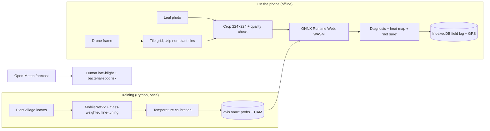

# 🌱 AVIS: Crop disease checks for Central Valley farmers

**AVIS (Autonomous Vegetation Imaging System)** is a free, offline-first phone app that helps
California Central Valley growers and farmworkers catch crop disease early. Photograph a leaf,
or upload a low-altitude drone photo, and an AI model **running entirely on the phone** checks it
for disease in about a second. It needs no cell signal, no account, and no upload.

> Built for the 2026 Congressional App Challenge. See [docs/SUBMISSION.md](docs/SUBMISSION.md) for the submission kit and demo script.


---

## Why AVIS

The Central Valley is one of the most productive farming regions in the world, and it has three problems a generic plant app doesn't solve:

| Problem in the Valley | What AVIS does |
|---|---|
| Weak or no cell signal out in the fields | The model and the whole app are cached on the phone, so scans work in airplane mode |
| Many growers and farmworkers speak Spanish or Punjabi | The full interface and disease guidance are in **English, Spanish and Punjabi**, with read-aloud |
| Late blight can destroy a tomato or potato field within weeks of cool, foggy weather | A **7-day risk forecast** warns *before* conditions favor disease |
| A wrong AI answer costs real money | AVIS shows **where** it saw disease, says **"not sure"** instead of guessing, and sends serious cases to a UC Cooperative Extension farm advisor or licensed PCA |
| Big fields can't be walked leaf by leaf | **Drone mode** splits aerial photos into zones and pins hot spots on a map using the photo's GPS |

## Features

- 📷 **Leaf scan.** Take a photo or upload one. On-device MobileNetV2 inference via ONNX Runtime Web (WebAssembly).
- 🔥 **Explainable results.** A class-activation heat map shows which part of the leaf drove the diagnosis.
- ❔ **Honest uncertainty.** Calibrated confidence (temperature scaling). AVIS says "not sure" below 60% confidence or when the photo has too little leaf in it.
- 📸 **Photo quality checks.** Warns when a photo is too dark, too bright, blurry, or has too little leaf.
- 🛸 **Drone / wide-photo mode.** Tiles each frame, skips soil and sky, scores plant zones, colors a scouting grid, and reads EXIF GPS. Accepts batch uploads.
- 🌦️ **Disease risk forecast.** Open-Meteo hourly weather plus the **Hutton criteria** for late blight and a warm-and-wet hour model for bacterial spot, for 14 Valley towns or your GPS location.
- 📘 **Action guide.** Symptoms, spread conditions, urgent steps and prevention, based on UC IPM guidance, with links to the official pages.
- 🗺️ **Private field log.** Scans are stored on the phone (IndexedDB) and shown as a list or map, with CSV export and a printable report.
- 🌐 **Three languages** and 🔊 **read-aloud** (Web Speech API).
- 📲 **Installable PWA.** Add it to the home screen on iPhone or Android, with no app store needed.

## What it detects

| Crop | Disease | Pathogen |
|---|---|---|
| Tomato | Late blight | *Phytophthora infestans* |
| Potato | Late blight | *Phytophthora infestans* |
| Bell pepper | Bacterial spot | *Xanthomonas* spp. |

Each crop also has a "healthy" class (six classes total).

## Model results

Trained with [ml/train.py](ml/train.py) on 4,722 PlantVillage images. The original validation folder was split by a hash of each filename into a **validation half** (model selection and calibration) and a **held-out test half** that the model never trained on. Everything below is measured on that test half.

| Metric | Value |
|---|---|
| Test accuracy | {{ACC}} |
| Macro F1 | {{F1}} |
| Calibration error (ECE), before → after temperature scaling | {{ECE}} |
| Test images | {{NTEST}} |
| Model size | {{SIZE}} MB (ONNX) |
| Training time | {{MIN}} min on an 8-core laptop CPU |

Per-class results, training curves and the confusion matrix are in [ml/results/](ml/results/).

> **Read these numbers carefully.** PlantVillage images are single leaves photographed in a lab on plain backgrounds. Field photos and web photos are much harder, so expect lower accuracy in real use. That's why AVIS shows uncertainty and points people to experts.

### What I fixed from my first prototype

My first version ([legacy/](legacy/)) was a Keras webcam script. I listed its problems and fixed each one:

| Prototype problem | Fix in AVIS |
|---|---|
| Fed BGR camera frames to a model trained on RGB images | The browser canvas gives RGB, and normalization is built into the exported model |
| No held-out test set | Deterministic validation/test split |
| 11× class imbalance, uncorrected | Class-weighted loss |
| Frozen backbone only | Two stages: train the head, then fine-tune the top MobileNetV2 blocks |
| Overconfident softmax and no "unsure" state | Temperature scaling plus a 60% abstention threshold and photo-quality checks |
| No random seeds | Seeded training (`SEED = 42`) |
| Desktop webcam only | Offline phone app plus drone-photo mode |

## How it works



## Run it

**App** (Node 20+):

```bash
cd app && npm install && npm run dev
```

Open the printed URL. To test on a phone on the same Wi-Fi network, run `npm run dev -- --host`. Production build: `npm run build`, which writes the output to `app/dist/`.

**Deploy.** Pushing to `main` runs [.github/workflows/deploy.yml](.github/workflows/deploy.yml), which publishes the app to GitHub Pages. Turn it on once under *Settings → Pages → Source: GitHub Actions*.

**Retrain the model** (Python 3.10–3.13):

```bash
python -m venv .venv && .venv/Scripts/activate  # macOS/Linux: source .venv/bin/activate
pip install -r ml/requirements.txt --extra-index-url https://download.pytorch.org/whl/cpu
python ml/train.py
```

Training writes `app/public/model/avis.onnx`, `model-info.json`, and the metrics and plots in `ml/results/`.

**Demo images.** `demo/leaves/` holds held-out test leaves. `demo/simulated_drone_frame.jpg` is a **simulated** drone frame built from test leaves by [ml/make_demo_mosaic.py](ml/make_demo_mosaic.py).

## Repository layout

```
app/        React + TypeScript PWA (the farmer-facing app)
  src/model.ts      on-device inference, heat maps, quality checks, drone tiling, EXIF GPS
  src/risk.ts       weather-driven disease risk models
  src/diseases.ts   disease guidance in EN / ES / PA
  src/i18n.ts       interface text in EN / ES / PA
ml/         training, evaluation and ONNX export (PyTorch)
dataset/    PlantVillage train/val images
demo/       demo images for presentations
docs/       Congressional App Challenge submission kit
legacy/     original Keras + OpenCV prototype
```

## Limitations (stated plainly)

1. Three diseases on three crops. Any other problem, such as powdery mildew, nutrient deficiency or pests, is outside what the model knows. AVIS may say "not sure," or it may be wrong.
2. Trained on lab images. Real field and drone performance **has not been validated yet**. Drone mode needs low flights (about 2–5 m) where individual leaves are visible.
3. The risk forecast uses published rules of thumb, not a calibrated local model. It's a prompt to scout, not a spray decision.
4. Spanish and Punjabi text should be reviewed by native-speaking growers.
5. AVIS is a screening tool, not a diagnosis. Treatment decisions belong with a UCCE farm advisor or licensed PCA.

## Roadmap

- Field-test with Central Valley growers and UCCE farm advisors; collect real field photos (with consent) to fine-tune
- Add Valley crops: grapes (powdery mildew), almonds (hull rot), pistachios
- Validate drone mode against ground-truth scouting
- Optional, opt-in anonymous outbreak map for neighboring growers

## Credits

- **PlantVillage**: Hughes & Salathé (2015), [arXiv:1511.08060](https://arxiv.org/abs/1511.08060)
- **MobileNetV2**: Sandler et al., CVPR 2018
- **UC IPM**: University of California Statewide Integrated Pest Management Program ([ipm.ucanr.edu](https://ipm.ucanr.edu/)), the source for disease guidance
- **Hutton criteria**: AHDB (2017) late-blight risk criteria
- Weather: [Open-Meteo](https://open-meteo.com/) · Maps: © OpenStreetMap contributors · Runtime: ONNX Runtime Web

## License

MIT; see [LICENSE](LICENSE). PlantVillage imagery is covered by its own upstream terms.
